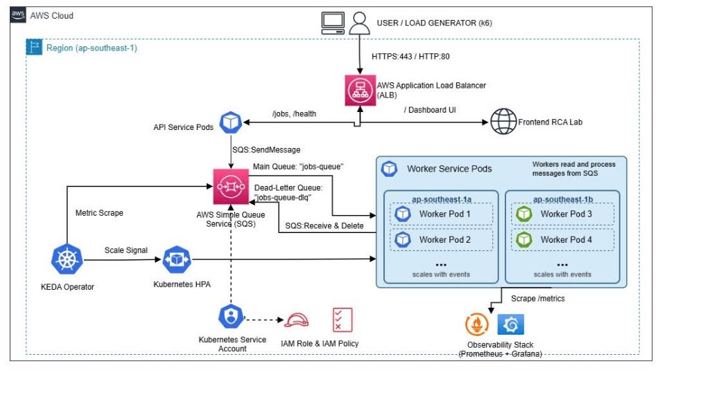
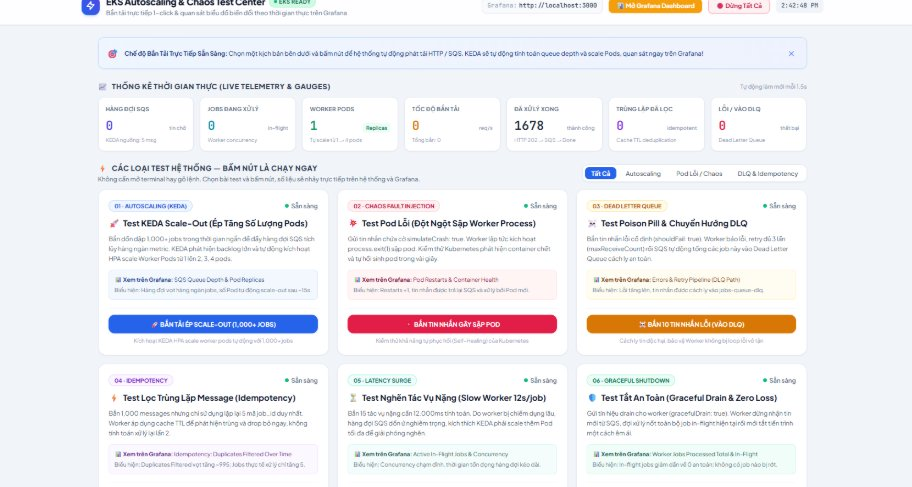
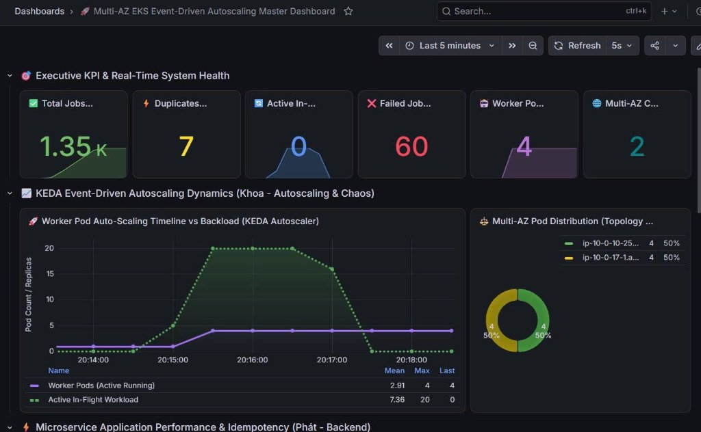

# EKS Event-Driven Autoscaling

A development project for an asynchronous API and worker system on Amazon EKS.
The API publishes jobs to Amazon SQS. A worker Deployment consumes them.
KEDA can scale workers from queue depth; an optional CPU HPA is provided for
comparison. Prometheus, Grafana, and Loki provide metrics and log collection.

> **Scope:** this repository contains a working infrastructure/application
> implementation plus experiment scaffolding. T0–T6 latency instrumentation,
> a Prometheus SQS queue-depth datasource, a CPU-intensive HPA workload, and
> automated chaos workflows are not complete. See [Next development steps](#next-development-steps).

## Architecture



```text
Client
  |
  v
AWS ALB -> API Service (EKS) -> Amazon SQS + DLQ -> Worker Deployment
                                                   ^       |
                                                   |       +-> /metrics
                                             KEDA 

Prometheus Operator -> Prometheus -> Grafana
Kubernetes logs -> Promtail -> Loki -> Grafana
```

Terraform provisions a VPC across two Availability Zones, an EKS managed node
group, SQS queues, ECR repositories, IAM roles/IRSA, AWS Load Balancer
Controller, EBS CSI driver, and an optional KEDA installation. Kubernetes
workloads are spread across available zones where scheduling capacity permits.
This project uses managed node groups; it does not configure Karpenter or
cluster autoscaling.

### EKS Autoscaling & Chaos Test Center (Frontend UI)

The frontend (`apps/frontend`, exposed at the root `/` via ALB Ingress) provides an interactive telemetry dashboard and chaos test center. It displays real-time SQS backlog depth, active worker concurrency, processed/error counts, and offers one-click scenario triggers (KEDA scale-out burst, worker crash injection, poison pill DLQ routing, idempotency deduplication, latency surge, and graceful shutdown):



## Repository map

| Path | Purpose |
| --- | --- |
| [`apps/`](apps/README.md) | Backend services and frontend dashboard |
| [`infra/`](infra/README.md) | Terraform bootstrap, EKS environment, and reusable modules |
| [`k8s/`](k8s/README.md) | Application, storage, ingress, topology, and autoscaling manifests |
| [`observability/`](observability/README.md) | Prometheus/Grafana, Loki/Promtail, and dashboard |
| [`scripts/`](scripts/README.md) | Local load test, chaos placeholders, and latency collection notes |
| [`docs/`](docs/README.md) | Architecture, experiments, fault tolerance, and evidence |

## Requirements

- AWS account with permissions to create EKS, VPC, EC2, IAM, SQS, ECR, ELB,
  S3, DynamoDB, Budgets, and EKS add-ons.
- AWS CLI v2, Terraform >= 1.6, kubectl compatible with the cluster version,
  Helm 3, Docker, and (for load tests) k6.
- A Docker-compatible shell for image build commands. Examples below use
  PowerShell from the repository root.
- Budget alert email addresses and the IAM principal ARNs that need EKS
  administrator access.

Review current AWS pricing before deploying. EKS, EC2, NAT Gateway, EBS,
load balancers, and data transfer can incur costs even when idle.

## Deployment

### 1. Configure AWS credentials and Terraform inputs

Authenticate with an AWS identity that can create the resources above and
confirm the account:

```powershell
aws sts get-caller-identity
```

Copy `infra\envs\dev\terraform.tfvars.example` to
`infra\envs\dev\terraform.tfvars`. Set the intended region, cluster name,
allowed Kubernetes API CIDRs, administrator principal ARNs, budget email
addresses, and node sizing. Restrict
`cluster_endpoint_public_access_cidrs`; do not leave `0.0.0.0/0` for a shared
or production environment. Keep `terraform.tfvars` and credentials out of Git.

KEDA is disabled by default. Keep `install_keda = false` for an initial
deployment unless you are ready to use the SQS autoscaler.

### 2. Prepare Terraform remote state

The `infra\bootstrap` configuration creates an encrypted, versioned S3 state
bucket and a DynamoDB lock table. Bootstrap it once if the configured backend
does not already exist:

```powershell
terraform -chdir=infra\bootstrap init
terraform -chdir=infra\bootstrap plan
terraform -chdir=infra\bootstrap apply
terraform -chdir=infra\bootstrap output
```

The dev backend values are in `infra\envs\dev\versions.tf`. Verify that the
bucket and lock-table names match the bootstrap outputs and that you are using
the intended account before initializing the dev environment. If changing an
already initialized backend, stop and determine whether state must be migrated;
do not use `-reconfigure` or `-migrate-state` as a guess.

### 3. Provision AWS infrastructure

```powershell
terraform -chdir=infra\envs\dev init
terraform -chdir=infra\envs\dev validate
terraform -chdir=infra\envs\dev plan -out=tfplan
terraform -chdir=infra\envs\dev apply tfplan
```

Review the plan for the correct AWS account, region, CIDRs, and expected
resources before applying. This provisions the cluster and supporting
resources; it can take several minutes and incurs AWS charges.

Connect kubectl and verify nodes and the EBS CSI add-on:

```powershell
aws eks update-kubeconfig --name multiaz-eks --region ap-southeast-1
kubectl get nodes -L topology.kubernetes.io/zone
aws eks describe-addon --cluster-name multiaz-eks --addon-name aws-ebs-csi-driver `
  --region ap-southeast-1 --query addon.status --output text
kubectl apply -f k8s\storage\ebs-gp3.yaml
kubectl get storageclass gp3
```

Use the actual cluster name and region from your Terraform variables. Wait for
the EBS CSI add-on to become `ACTIVE` before installing charts that create
persistent volume claims.

### 4. Build and push application images

Read Terraform outputs:

```powershell
$region = terraform -chdir=infra\envs\dev output -raw region
$apiImage = terraform -chdir=infra\envs\dev output -raw ecr_api_url
$workerImage = terraform -chdir=infra\envs\dev output -raw ecr_worker_url
$frontendImage = "867703356304.dkr.ecr.ap-southeast-1.amazonaws.com/multiaz-autoscaling/frontend"
$registry = $apiImage.Split('/')[0]
aws ecr get-login-password --region $region |
  docker login --username AWS --password-stdin $registry
docker build -t "${apiImage}:latest" -f apps\backend\api-service\Dockerfile apps\backend\api-service
docker push "${apiImage}:latest"
docker build -t "${workerImage}:latest" -f apps\backend\worker-service\Dockerfile apps\backend\worker-service
docker push "${workerImage}:latest"
docker build --build-arg NGINX_CONFIG=nginx.eks.conf `
  -t "${frontendImage}:latest" -f apps\frontend\Dockerfile apps\frontend
docker push "${frontendImage}:latest"
```

The EKS nodes need permission to pull from these ECR repositories. For
repeatable deployments, prefer immutable version tags or commit SHAs over
`latest`.

### 5. Configure and deploy Kubernetes workloads

Before deployment, replace the queue URL placeholder in
`k8s\config\configmap.yaml` with:

```powershell
terraform -chdir=infra\envs\dev output -raw queue_url
```

The deployment image placeholders are replaced after applying the Kustomize
manifests. Create the app resources, set the exact images, then annotate the
service accounts with the Terraform-created IRSA roles:

```powershell
kubectl apply -k k8s
$apiRoleArn = terraform -chdir=infra\envs\dev output -raw api_role_arn
$workerRoleArn = terraform -chdir=infra\envs\dev output -raw worker_role_arn
if ([string]::IsNullOrWhiteSpace($apiRoleArn) -or
    [string]::IsNullOrWhiteSpace($workerRoleArn)) {
  throw "Terraform did not return both application IRSA role ARNs."
}
kubectl annotate serviceaccount api -n app `
  "eks.amazonaws.com/role-arn=$apiRoleArn" --overwrite
kubectl annotate serviceaccount worker -n app `
  "eks.amazonaws.com/role-arn=$workerRoleArn" --overwrite
kubectl set image deployment/api-service api="${apiImage}:latest" -n app
kubectl set image deployment/worker-service worker="${workerImage}:latest" -n app
# deployment-frontend.yaml already uses frontend:latest; restart to pull its newly pushed image.
kubectl rollout restart deployment/frontend-service -n app
kubectl rollout status deployment/api-service -n app
kubectl rollout status deployment/worker-service -n app
kubectl rollout status deployment/frontend-service -n app
kubectl get ingress api-ingress -n app
```

Wait for the ALB address to appear in the Ingress. Confirm API and worker logs
show successful SQS operations; if a worker reports the node-group role rather
than its IRSA role, verify the `worker` service account annotation and restart
the pods.

### 6. Enable one autoscaler

**KEDA / SQS (recommended event-driven mode):** set `install_keda = true` in
`terraform.tfvars`, then run `terraform plan` and `terraform apply`. Verify
`scaledobjects.keda.sh` exists before applying
`k8s\autoscaling\keda-scaledobject.yaml`. Set its `queueURL` to the Terraform
queue output first. KEDA uses its own `keda` IRSA role; the worker uses a
separate IRSA role.

**CPU HPA (baseline only):** do not apply the KEDA ScaledObject. Install
Kubernetes Metrics Server separately, verify `kubectl top pods -n app` works,
then apply `k8s\autoscaling\hpa-baseline.yaml`.

Never let KEDA and the CPU HPA control `worker-service` at the same time.
The current worker simulates work with a timer and is not CPU-intensive, so
the existing k6 workload may not cause the CPU HPA to scale.

### 7. Install monitoring

Follow [`observability/README.md`](observability/README.md). In summary,
create the `observability` namespace and Grafana credential Secret, install
the kube-prometheus-stack and Loki/Promtail Helm charts using the provided
values, then apply `observability\prometheus\api-podmonitor.yaml`. Worker
metrics use the existing ServiceMonitor in `k8s\config`. Ensure the relevant
claims use the `gp3` StorageClass and become `Bound`.

Import `observability\grafana\dashboards\worker-monitoring.json`. The dashboard
shows worker counters/gauges, SQS queue depth, Kubernetes replicas, processing
latency, and Pod readiness. T0–T6 event latency is available in the collected
experiment evidence.



### 8. Smoke test and load test

Get the ALB hostname and run a small test before the staged workload:

```powershell
kubectl get ingress api-ingress -n app
k6 run -e API_URL=http://<ALB-HOSTNAME> scripts\load-test\k6-workload.js
```

Watch API and worker logs, worker metrics, the selected autoscaler, and SQS
queue depth in CloudWatch. The k6 script sends jobs to the configured AWS
queue; use a development environment, not production.

### 9. Tear down and control costs

Delete Kubernetes Ingress resources and wait for their ALBs to be removed
before destroying the cluster. Review Terraform's destroy plan carefully.
The bootstrap state bucket and lock table are separate resources and should
normally be retained.

## Local development

The local compose stack uses ElasticMQ instead of AWS SQS:

```powershell
docker compose -f docker-compose.local.yml up --build
```

Frontend: `http://localhost:8181`; API: `http://localhost:3000`; worker health and metrics:
`http://localhost:3001/health` and `http://localhost:3001/metrics`.
The Failure Scenarios page can start two bounded local tests: `traffic-spike`
(up to 20 `POST /jobs` requests) and `sqs-backlog-spike` (up to 12 queued jobs).
Stop prevents further jobs from being sent; jobs already accepted by SQS may
still be processed.
Database, deploy, network, storage, and poison-message scenarios are disabled
because this Compose stack does not provide safe implementations for them.
Chaos controls are enabled only by the local Compose configuration and its
frontend/API ports bind to loopback.
Send a job with:

```powershell
Invoke-RestMethod -Method Post -Uri http://localhost:3000/jobs `
  -ContentType 'application/json' `
  -Body '{"payload":{"test":true},"processTimeMs":500}'
```

## Next development steps

1. Instrument and document T0–T6 timestamps with a consistent clock and
   publish latency histograms/measurements.
2. Integrate SQS queue depth into Prometheus/Grafana (for example via
   CloudWatch exporter or an approved metrics adapter).
3. Add worker processing-duration histograms and API request metrics.
4. Provide a bounded CPU workload mode and install Metrics Server for a valid
   HPA comparison.
5. Add dashboard panels and alerts for KEDA/HPA state, queue depth, retries,
   DLQ, pod readiness, and latency.
6. Add additional scenario implementations only alongside their dependencies,
   cleanup behavior, bounded limits, and environment guards.
7. Pin and test Helm chart versions; establish backups and production-grade
   storage/retention for Loki and Prometheus.
8. Add automated tests, image scanning policy, and immutable image tags.

## Documentation

See each top-level directory README for subsystem-specific configuration and
the [`docs/`](docs/README.md) index for experiment and fault-tolerance notes.
